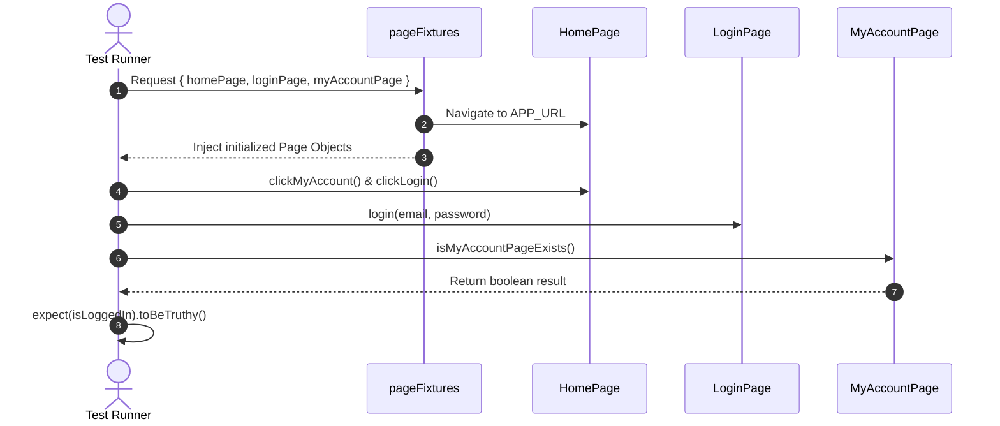
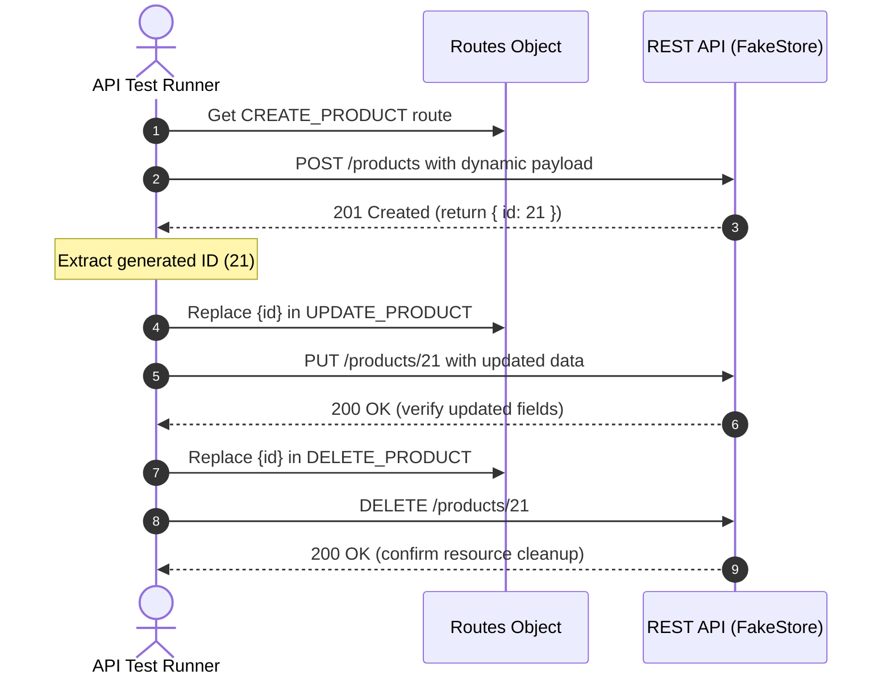

# 🎭 Playwright + TypeScript Multi-Layer Automation Framework

A production-grade, enterprise-ready automation testing framework built using **Playwright**, **TypeScript**, and modern software testing design patterns.

The framework provides an end-to-end testing solution covering three distinct layers:
1. **Web UI Automation** — Page Object Model (POM) with custom fixtures and auto-waiting
2. **REST API Automation** — Playwright `request` context, centralized routes, AJV JSON Schema validation, and CRUD workflows
3. **Database (DB) Automation** — Relational database validation (MySQL) for full data-integrity checks

---

## 📑 Table of Contents

- [Architecture Overview](#-architecture-overview)
- [Tech Stack](#-tech-stack)
- [Directory Structure](#-directory-structure)
- [Framework Layers](#-framework-layers)
  - [1. Web UI Testing](#1-web-ui-testing)
  - [2. REST API Testing](#2-rest-api-testing)
  - [3. Database Testing](#3-database-testing)
- [Test Data & Utilities](#-test-data--utilities)
- [Getting Started](#-getting-started)
  - [Prerequisites](#prerequisites)
  - [Installation](#installation)
  - [Environment Configuration](#environment-configuration)
- [Running Tests](#-running-tests)
  - [Run by Test Layer](#run-by-test-layer)
  - [Run by Tags](#run-by-tags)
  - [Browser & Execution Modes](#browser--execution-modes)
- [Reporting](#-reporting)
- [Architecture & Flow Diagrams](#-architecture--flow-diagrams)
- [Best Practices](#-best-practices)

---

## 🏛 Architecture Overview

```
                               ┌─────────────────────────────┐
                               │   Playwright Test Runner    │
                               │        (@playwright/test)   │
                               └──────────────┬──────────────┘
                                              │
              ┌───────────────────────────────┼───────────────────────────────┐
              │                               │                               │
              ▼                               ▼                               ▼
    ┌───────────────────┐           ┌───────────────────┐           ┌───────────────────┐
    │      Web UI       │           │     REST API      │           │     Database      │
    │   (tests/web/)    │           │   (tests/api/)    │           │    (tests/db/)    │
    └─────────┬─────────┘           └─────────┬─────────┘           └─────────┬─────────┘
              │                               │                               │
              ▼                               ▼                               ▼
    ┌───────────────────┐           ┌───────────────────┐           ┌───────────────────┐
    │  Page Object POM  │           │   Routes / APIs   │           │    MySQL Client   │
    │ (pages/, fixtures)│           │  (api/endpoints/) │           │ (utils/dbClient)  │
    └─────────┬─────────┘           └─────────┬─────────┘           └─────────┬─────────┘
              │                               │                               │
              ▼                               ▼                               ▼
    ┌───────────────────┐           ┌───────────────────┐           ┌───────────────────┐
    │ Dynamic / JSON    │           │ JSON Schemas(AJV) │           │ Data Integrity    │
    │  Test Data & Util │           │  (api/schemas/)   │           │ Validation        │
    └───────────────────┘           └───────────────────┘           └───────────────────┘
```

---

## 🛠 Tech Stack

| Technology | Purpose |
| :--- | :--- |
| **[Playwright](https://playwright.dev/)** `^1.64.1` | Unified cross-browser Web and API automation engine |
| **[TypeScript](https://www.typescriptlang.org/)** `ES2022 / Node16` | Type safety, maintainability, and autocomplete |
| **[@faker-js/faker](https://fakerjs.dev/)** | Dynamic and realistic synthetic test data generation |
| **[AJV](https://ajv.js.org/)** | JSON Schema validation for contract compliance |
| **[dotenv](https://github.com/motdotla/dotenv)** | Secure environment variable and secrets management |
| **[mysql2](https://github.com/sidorares/node-mysql2)** | MySQL database client for backend DB assertions |
| **[@axe-core/playwright](https://github.com/dequelabs/axe-core-npm)** | Accessibility compliance testing |
| **[Allure Playwright](https://allurereport.org/)** | Comprehensive rich reporting |
| **[xlsx & csv-parse](https://sheetjs.com/)** | File readers for data-driven testing |

---

## 📂 Directory Structure

```
Playwright_Opencart_AI/
├── .env                          # Local environment variables & secrets (ignored by git)
├── .env.example                  # Sanitized template for environment configuration
├── .gitattributes                # Line-ending and binary file definitions
├── .gitignore                    # Ignored artifacts (node_modules, reports, .env)
├── package.json                  # Dependencies and scripts
├── playwright.config.ts          # Central Playwright runner configuration
├── tsconfig.json                 # TypeScript strict compiler options
│
├── api/                          # REST API layer assets
│   ├── endpoints/
│   │   └── routes.ts             # Centralized route constants
│   └── schemas/                  # JSON response schemas (AJV)
│       ├── cart_api_schema.json
│       ├── product_api_schema.json
│       └── user_api_schema.json
│
├── fixtures/                     # Dependency Injection fixtures
│   └── pageFixtures.ts           # Extended Playwright test with Page Objects
│
├── pages/                        # Page Object Model classes
│   ├── AccountCreatedPage.ts     # Registration confirmation page
│   ├── CartPage.ts               # Shopping cart interaction & validation
│   ├── HomePage.ts               # Home navigation, search, menus
│   ├── LoginPage.ts              # Customer login actions & errors
│   ├── LogoutPage.ts             # Logout confirmation
│   ├── MyAccountPage.ts          # Customer account dashboard
│   ├── ProductPage.ts            # Product details & add-to-cart
│   ├── RegisterPage.ts           # Customer registration form
│   └── SearchResultsPage.ts      # Product search results & selection
│
├── prompts/                      # Context & specification prompt drivers
│   ├── db_test_prompt.md         # Database test scenarios
│   └── fakestore_api_test_prompts.md # 34 REST API test scenarios
│
├── testdata/                     # External data files for data-driven tests
│   └── opencart_logindata.json   # Parameterized login test cases
│
├── tests/                        # Automated Test Suites
│   ├── api/                      # REST API Test Specs (FakeStore API)
│   │   ├── auth.spec.ts          # Login & Token retrieval (Scenarios 1–2)
│   │   ├── products.spec.ts      # Products CRUD, filter, sort (Scenarios 3–12)
│   │   ├── users.spec.ts         # Users CRUD, filter, sort (Scenarios 13–19)
│   │   ├── carts.spec.ts         # Carts CRUD, date range, limits (Scenarios 20–28)
│   │   ├── schemas.spec.ts       # JSON Schema validation with AJV (Scenarios 29–31)
│   │   └── workflows.spec.ts     # E2E CRUD Workflows with ID chaining (Scenarios 32–34)
│   ├── db/                       # Database Test Specs
│   │   └── customer-registration-db.spec.ts # UI + Admin + MySQL DB E2E validation
│   └── web/                      # Web UI Test Specs (OpenCart / TutorialsNinja)
│       ├── add-product-to-cart.spec.ts
│       ├── e2e-shopping-flow.spec.ts
│       ├── invalid-login.spec.ts
│       ├── login-data-driven.spec.ts
│       ├── logout.spec.ts
│       ├── product-search.spec.ts
│       ├── user-registration.spec.ts
│       └── valid-login.spec.ts
│
└── utils/                        # Shared Framework Utilities
    ├── CustomReporter.ts         # Real-time styled HTML dashboard reporter
    ├── DataReader.ts             # JSON, CSV, and XLSX file reader
    ├── dataGenerator.ts          # Faker-backed synthetic data & payload generator
    ├── dbClient.ts               # MySQL promise connection & query executor
    └── helper.ts                 # Static data helpers & formatters
```

---

## 🧩 Framework Layers

### 1. Web UI Testing

- **Design Pattern**: Page Object Model (POM). Locators and interactions reside inside page classes (`pages/`), keeping tests clean and readable.
- **Fixture Injection**: Tests import `test` and `expect` from `fixtures/pageFixtures.ts`. Required page objects are passed directly into the test arguments (e.g., `({ homePage, loginPage })`), eliminating manual page instantiation.
- **Auto-Waiting**: Relies on Playwright's web-first assertions (`expect(locator).toBeVisible()`) without hardcoded sleeps (`waitForTimeout`).
- **Data-Driven Specs**: `login-data-driven.spec.ts` dynamically loops over `testdata/opencart_logindata.json` to validate positive and negative login combinations.

### 2. REST API Testing

- **Target API**: [FakeStore API](https://fakestoreapi.com/)
- **Routes Architecture**: Endpoints are centralized in `api/endpoints/routes.ts` with parameter placeholders (e.g., `/products/{id}`, `/carts?startdate={startdate}&enddate={enddate}`).
- **JSON Schema Validation**: Uses **AJV** with draft-07 schemas (`api/schemas/`) to enforce strict API response contract validation.
- **CRUD Workflows**: End-to-end tests chain responses dynamically (Create Resource → capture generated ID → Update Resource → Delete Resource).

### 3. Database Testing

- **Client Utility**: `utils/dbClient.ts` provides reusable async SQL query execution via `mysql2/promise`.
- **E2E Data Integrity**: Validates that operations initiated on the Web UI (e.g. user registration) are correctly persisted in the MySQL database tables (e.g. `oc_customer`).
- **Safe Isolation**: Reference tests in `tests/db/` are configured with `test.skip` to prevent false failures in environments without local database instances.

---

## 🎲 Test Data & Utilities

- **`RandomDataUtil` (`utils/dataGenerator.ts`)**:
  - Person details: Names, emails, passwords, phones.
  - Address details: City, street, zip, coordinates.
  - Commerce: Product names, descriptions, prices, categories.
  - Complete API payloads: `generateProductPayload()`, `generateUserPayload()`, `generateCartPayload()`.
- **`DataProvider` (`utils/DataReader.ts`)**:
  - `readJson(filePath)`: Synchronous JSON reader.
  - `readCsv(filePath)`: Sync CSV parser.
  - `readExcel(filePath)`: XLSX sheet converter.
- **`Helper` (`utils/helper.ts`)**:
  - Currency/price format parsers and static login test data.

---

## 🚀 Getting Started

### Prerequisites

- [Node.js](https://nodejs.org/) (version 18 or higher recommended)
- npm or yarn

### Installation

1. **Clone the repository:**
   ```powershell
   git clone <repository-url>
   cd Playwright_Opencart_AI
   ```

2. **Install project dependencies:**
   ```powershell
   npm install
   ```

3. **Install Playwright browsers:**
   ```powershell
   npx playwright install chromium
   ```

### Environment Configuration

Copy the sample environment file to create your local `.env`:
```powershell
copy .env.example .env
```
Update `.env` with your URLs and credentials:
```ini
# Web Configuration
WEB_APP_URL=https://tutorialsninja.com/demo/
APP_EMAIL=your_email@example.com
APP_PASSWORD=your_password

# API Configuration
API_BASE_URL=https://fakestoreapi.com
USERNAME=mor_2314
PASSWORD=83r5^_

# Database Configuration (Optional)
DB_HOST=localhost
DB_USER=root
DB_PASSWORD=
DB_NAME=openshop
DB_PORT=3306
```

---

## 🧪 Running Tests

### Run by Test Layer

| Suite | Command |
| :--- | :--- |
| **All Tests** | `npx playwright test` |
| **All API Tests** | `npx playwright test tests/api/` |
| **All Web UI Tests** | `npx playwright test tests/web/` |
| **Database Tests** | `npx playwright test tests/db/` |

### Run Specific Test Files

```powershell
# Run API Authentication tests
npx playwright test tests/api/auth.spec.ts

# Run Products API tests
npx playwright test tests/api/products.spec.ts

# Run Web Login tests
npx playwright test tests/web/valid-login.spec.ts

# Run E2E Shopping Flow
npx playwright test tests/web/e2e-shopping-flow.spec.ts
```

### Run by Tags

Tests are categorized using annotations in their titles:

```powershell
# Run all master suite tests
npx playwright test --grep "@master"

# Run smoke / sanity tests
npx playwright test --grep "@sanity"

# Run regression suite
npx playwright test --grep "@regression"

# Run API-only tests
npx playwright test --grep "@api"

# Run JSON Schema tests
npx playwright test --grep "@schema"

# Run Data-Driven tests
npx playwright test --grep "@datadriven"

# Run End-to-End workflow tests
npx playwright test --grep "@end-to-end"
```

### Browser & Execution Modes

```powershell
# Headed mode (visible browser window)
npx playwright test tests/web/ --headed

# Debug mode with Playwright Inspector
npx playwright test --debug

# Run in UI Mode (interactive test runner)
npx playwright test --ui
```

---

## 📊 Reporting

The framework is configured with multiple reporting formats simultaneously (`playwright.config.ts`):

1. **Standard Playwright HTML Report**:
   ```powershell
   npx playwright show-report reports
   ```
2. **Custom Real-time HTML Dashboard Report**:
   - Stored automatically under `custom-report/report_<timestamp>.html`.
   - Includes test metrics, duration, visual status cards, and live logs.
3. **JUnit XML Report**:
   - Saved to `reports/results.xml` for CI/CD integration (Jenkins, Azure DevOps, GitHub Actions).
4. **Allure Report**:
   - Results captured under `allure-results/`.
   - To view:
     ```powershell
     npx allure serve allure-results
     ```

---

## 📈 Architecture & Flow Diagrams

### Web UI Flow (Page Object Model)



### API CRUD Workflow



---

## 💎 Best Practices

- **Zero Hardcoded Sleeps**: Auto-waiting and event assertions are used instead of `waitForTimeout()`.
- **Decoupled Architecture**: Page Objects never make assertions; they return values or states. Assertions are always performed inside test steps.
- **Dynamic Test Data**: Faker generates fresh, unique inputs for every run to prevent data collisions.
- **Contract Integrity**: Every API response structure is guarded by compiled AJV JSON schemas.
- **Secure Secrets**: All sensitive passwords, tokens, and endpoints are kept in `.env` and excluded from version control.
